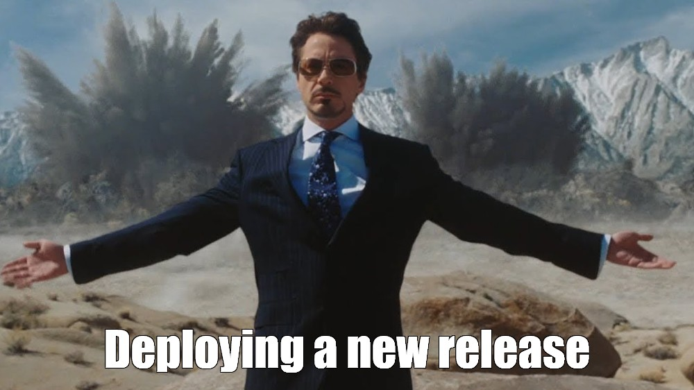
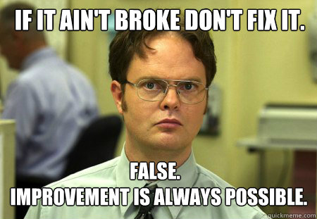
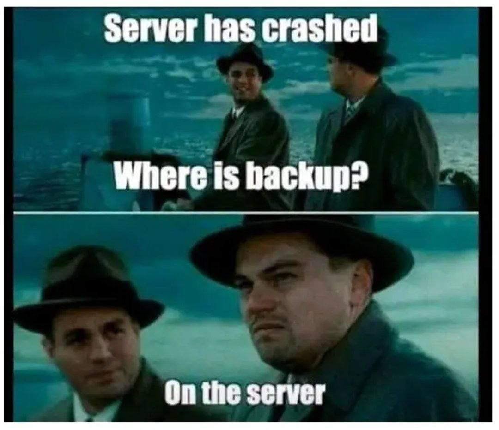
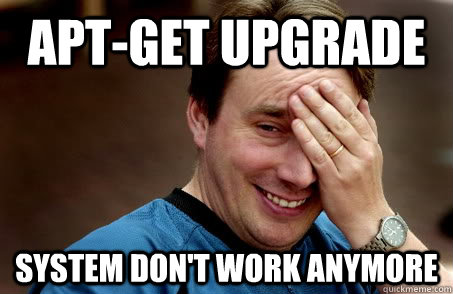
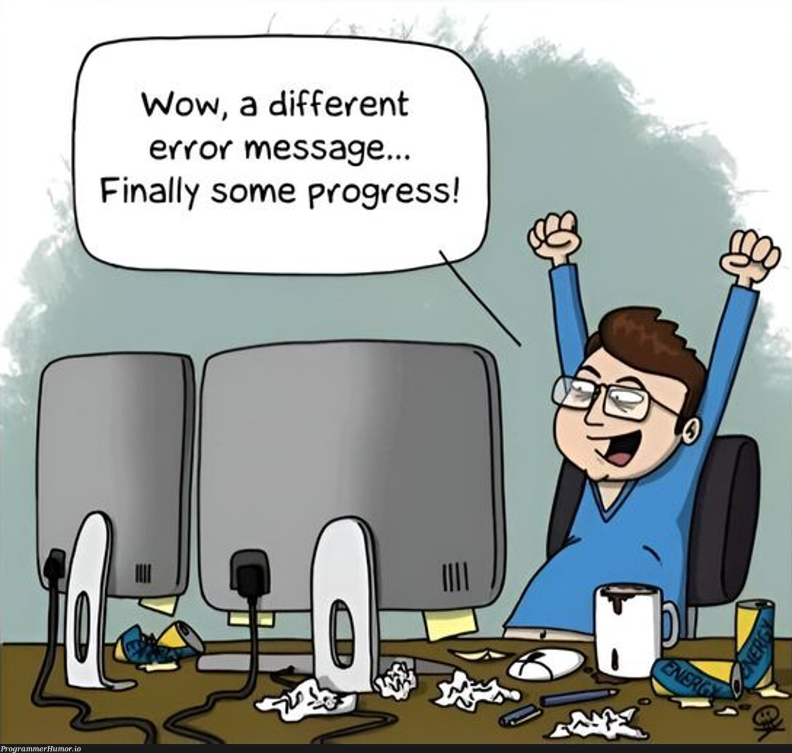
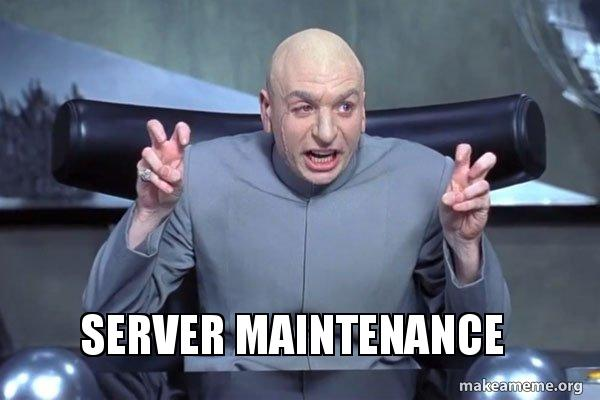
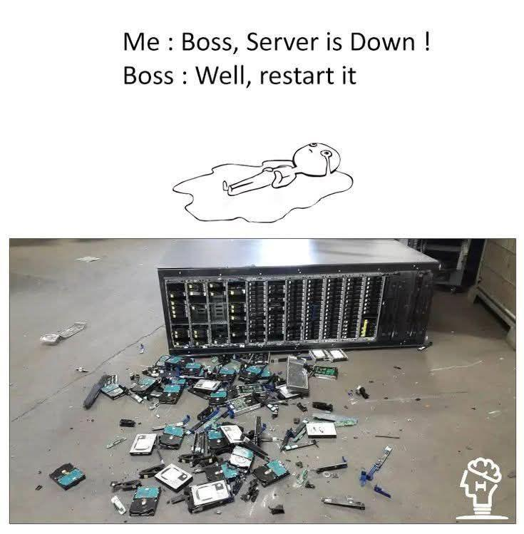
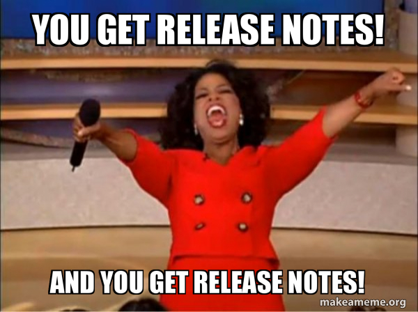
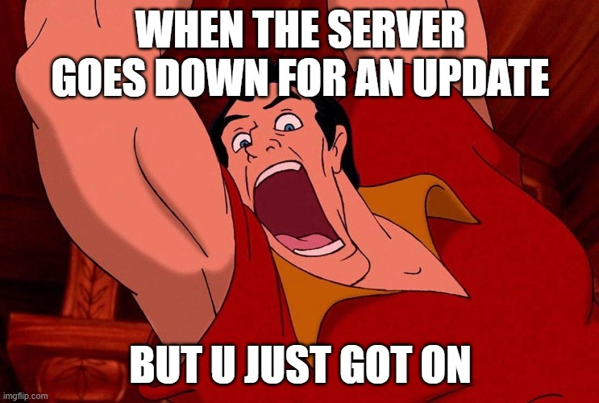

## Easy, painless upgrades

:::::: {.flow}

::: {.flow-card .flow-before}
[Today]{.label}


Upgrades feel risky, so they get put off.
:::

::: {.flow-arrow}
→
:::

::: {.flow-card .flow-after}
[After this talk]{.label}



Upgrades are planned, tested, and boring.
:::

::::::

::: {.goal}
**My goal:** help you go forth and upgrade **with confidence**. We'll cover the five most common ways upgrades go wrong, and what to do instead.
:::

::: notes
Press the S key (or use the Navigation Menu) to show the speaker view.

Welcome! Today is a tour of the upgrade mistakes I've seen (and maybe made). Each one comes with what goes wrong and what to do instead.

I'm one of Posit's onboarding engineers. I've helped a lot of teams install, and a lot of teams recover. Today is a tour of the ways upgrades go wrong. Every story in here really happened (details changed to protect the innocent).
:::

## How to ruin your weekend

{fig-align="center" width=35%}

:::: {.columns}

::: {.column width="50%"}
1. **YOLO: no staging, no backups**
2. **The in-place OS upgrade**
3. **Forgetting annual maintenance**
4. **Just not upgrading, ever**
5. **Not reading the release notes**

**Bonus:** Surprise! 🎁
:::

::::

::: notes
For each one: the anti-pattern, what actually breaks, and what to do instead. At the end, we turn all of them into a checklist.
:::

## A note on the stories

::: {.horror}
[Real-life examples]{.label}

Every story in this talk comes from a real reported issue. Names, companies, hostnames, identifying numbers, even identifying stories have been removed. 
:::

<br>

If you recognize yourself: you're not alone, and that's the point. 💜

# 1. Just not upgrading, ever {background-color="#17212b"}

##  Just not upgrading, ever 

{fig-align="center" width=23%}

> "If it ain't broke, don't fix it."

- "We'll upgrade when something breaks"
- Still running a version from years ago
- Every upgrade is huge and scary, so it keeps getting pushed back... which makes it bigger and scarier

## Just not upgrading, ever: what goes wrong

{fig-align="center" width=34%}

- **Out of support:** "Each Software Edition is eligible for Support Services from its YYYY.MM date for **18 months**."
- Unpatched security vulnerabilities
- New R, Python, and OS versions aren't supported on old releases
- The eventual upgrade crosses **many** schema migrations and changes at once

::: aside
Exact end-of-support dates: <https://docs.posit.co/supported-versions/>
:::

## Real-life examples: years in one jump

::: {.horror}
[Real-life example]{.label}

A customer was still on Package Manager **1.2.0** years after it shipped, when the expired internal certificate broke their git builders. Support's first step: get them onto a current release.
:::

::: {.horror}
[Real-life example]{.label}

After a Workbench upgrade from an older release on PostgreSQL, the admin **Users page showed "End of file"**. Existing users had a NULL in a column the new version required. The fix was hand-written SQL.

The suspected cause: an earlier **upgrade → downgrade → upgrade** had left the schema inconsistent.
:::

<br>

::: {.lesson}
Odd upgrade histories break in odd ways. The longer you wait, the less tested your path is, and the more the backup matters.
:::

::: notes
Also see the "migration that ate the disk" story from section 2 (YOLO). That's the never-upgrading story too: a large version jump plus years of metrics data.
:::

## Just not upgrading, ever: do this instead

{fig-align="center" width=40%}

- **Upgrade on a regular cadence** (e.g., quarterly), so each upgrade is small and boring
- **Boring upgrades are the goal**
- Practice makes the process routine: runbook, staging, backups, testing
- Know your dates: <https://docs.posit.co/supported-versions/>


# 2. YOLO {background-color="#17212b"}

## YOLO: the anti-pattern

{fig-align="center" width=27%}

> "We only have one server. It's production. It's fine."

- No staging environment, only production
- No backups (or backups nobody has ever tested)
- No rollback plan
- Upgrade run straight from the terminal, live, on a Friday afternoon

## YOLO: what goes wrong

{fig-align="center" width=28%}

### There is no undo button

- Upgrades run **database schema migrations**. Once they run, the old version may not work with the new schema.
- "Just reinstall the old version" isn't a rollback plan. Rolling back means **restoring the backup** of the database and data directory.
- No backup → no rollback → a very long night
- Something you could have caught in staging gets found by your users in production

::: notes
Connect docs: create a backup of the Connect database and data directory before upgrading, so you can roll back if you need to. The same idea applies to Workbench and Package Manager.
:::

## Real-life examples: straight to production

::: {.horror}
[Real-life example]{.label}

On RHEL with just-in-time user provisioning, an RPM upgrade of Workbench **removed a library symlink and stripped an entry from `/etc/nsswitch.conf`**. Workbench then failed at the next restart, and users were locked out.
:::

::: {.horror}
[Monday morning]{.label}

After a Workbench upgrade on Kubernetes, users' **suspended sessions crashed on resume**. The new server passed a flag the old session images didn't understand.
:::

::: {.lesson}
Both of these would have shown up in a staging environment that matched production: same OS, same auth setup, same session images. **Staging is where you find out, not your users.**
:::

::: notes
The Monday-morning story is from a Posit-internal server. Use "even we hit this" framing or drop it.

TODO: ask Support for a customer story about unattended-upgrades silently upgrading a product. GitHub didn't have a strong one.
:::

## Real-life examples: the migration that ate the disk

::: {.horror}
[Real-life example]{.label}

A customer jumped Connect forward about a year of releases, on PostgreSQL. They had **~300 million rows** of usage metrics and no retention policy.

One schema migration copied the whole metrics history into a new table in a single transaction. That **filled the database disk**. The transaction failed, and **Connect wouldn't start.** There was no warning first and no progress indicator.

The fix: stop Connect, delete old metric rows, `VACUUM FULL`, add disk, and try again.
:::

::: {.horror}
[Sequel]{.label}

A later migration changed metrics columns from `INTEGER` to `BIGINT`. One ~50 GB database grew to **~180 GB** during the rewrite, ran out of disk mid-migration, and **production went down**.
:::

::: {.lesson}
Test the upgrade on a **copy of production-sized data**. A migration can need several times the disk you think.

**Before you upgrade:** check you have free disk of several times your database size, and trim old usage data.
:::

## YOLO: do this instead

{fig-align="center" width=27%}

:::: {.columns}

::: {.column width="50%"}
**Have a staging environment**

- Same OS, config, auth, and integrations as production
- Restore a **copy of the production database** into staging
- Upgrade staging first, test, *then* production
- Bonus: it's also where you try new features
:::

::: {.column width="50%"}
**Back up before every upgrade**

- Stop the service first. Backups of a running server are not consistent.
- Back up the data directory, the database (SQLite file or PostgreSQL dump), the configs (`/etc/rstudio`, `/etc/rstudio-connect`, `/etc/rstudio-pm`), and the **encryption keys**
- **Test the restore.** A backup you've never restored is a hope, not a backup.
:::

::::

## Backups: the commands {visibility="hidden"}

::: {.panel-tabset}

### Workbench

```bash
sudo rstudio-server suspend-all   # suspend sessions if backing up user state
sudo rstudio-server stop
# back up:
#   /etc/rstudio/
#   /var/lib/rstudio-server/       (SQLite DB rstudio.sqlite + secure-cookie-key)
#   /var/lib/rstudio-launcher/
#   /var/log/rstudio/rstudio-server/   /var/log/rstudio/launcher/
#   ~/.config/rstudio and ~/.local/share/rstudio for each user
sudo rstudio-server start
```

PostgreSQL: follow PostgreSQL's own backup docs (e.g. `pg_dump`).

### Connect

```bash
sudo systemctl stop rstudio-connect
sudo tar cvpzf /mnt/backups/rstudio-connect.tar.gz /var/lib/rstudio-connect
sudo cp -a /etc/rstudio-connect/rstudio-connect.gcfg /mnt/backups/
sudo -u postgres pg_dump connect > connect-backup.sql   # if using PostgreSQL
sudo systemctl start rstudio-connect
```

The encryption key is `/var/lib/rstudio-connect/db/secret.key`. If you lose it, all encrypted settings and content environment variables are lost.

### Package Manager

```bash
sudo systemctl stop rstudio-pm
# back up:
#   /etc/rstudio-pm/
#   /var/lib/rstudio-pm/    (incl. ALL files in db/ because of the WAL file)
#   /var/lib/rstudio-pm/persistent/encryption/rstudio-pm.key
#   any customized storage locations, and S3 if you use it
sudo systemctl start rstudio-pm
```

⚠️ If the key is missing, Package Manager **silently generates a new one and starts normally**. Stored Git credentials can no longer be decrypted.

:::

::: notes
The Package Manager key behavior is the sneaky one: no error, no failure, just broken Git builders later.
:::

# 3. In-place OS upgrades {background-color="#17212b"}

## In-place OS upgrades

{fig-align="center" width=40%}

> "Ubuntu 22.04 → 24.04? There's a command for that!"

- `do-release-upgrade` (or `leapp` on RHEL) on the server running Posit Team
- Upgrading the OS *and* the Posit products in the same maintenance window

## In-place OS upgrades: what goes wrong

{fig-align="center" width=21%}

::: {.terminal}
[error while loading shared libraries: libssl.so.1.1: cannot open shared object file: No such file or directory]{.err}
:::

<br>

Upgrading the OS also updates system libraries. The updated system libraries are often incompatible with older R and Python package versions, package binaries installed under the old OS, or other software.

- R, Python, Quarto, and the Posit products **are not upgraded by the OS upgrade** → they break. They all need to be reinstalled.
- System libraries change versions (`libssl`, `libcurl`, `libicu`, `gdal`, ...). The Posit product package is built for a specific OS version too. 
- Compiled packages in user libraries and **Connect runtime caches** are built for the old OS.
- Package Manager binaries are built **per OS version**. Repo URLs pointing at the old OS now give you the wrong binaries.
- The kicker: problems are "often intermittent, difficult to troubleshoot, and could arise **months after the upgrade**."

::: notes
This is the one that causes the most mysterious "it worked yesterday" errors. Loads of packages break in ways that look unrelated.
:::

## Real-life examples: "Why is everything broken?"

::: {.horror}
[Real-life example]{.label}

A Connect customer upgraded the OS in place and **didn't purge Connect's R and Python runtime caches**. Those packages were built against the old system libraries. Content started failing to render.
:::

::: {.horror}
[Even we're not immune]{.label}

Moving a Connect server from Ubuntu 22.04 to 26.04, a test build of package samples found old versions of `later`, `xml2`, `XML`, `terra`, and `RcppParallel` **don't compile** with the new GCC, libxml2, and GDAL.

The result: **130 content items, 43 owners**, each emailed by hand. A real content test then found two more failures (`systemfonts`, `duckdb`) that the sample missed.
:::

<br>

::: {.lesson}
Test-build **your real content** on the new OS before you switch. The sample caught 5 broken packages. **The real content test caught 2 more.**
:::

::: notes
The second story is from a Posit-internal server. Use "even we hit this" framing or drop it for a customer audience.
:::

## In-place OS upgrades: do this instead

**Build a new server and migrate.** Posit's two-phase method:

:::: {.columns}

::: {.column width="50%"}
**Phase 1: build staging on the new OS**

- Install the Posit products, R, Python, and Quarto built for that OS
- Point Package Manager repo URLs at the new OS binaries
- Same config, auth, and integrations
:::

::: {.column width="50%"}
**Phase 2: migrate data**

- Shut down production for consistent snapshots
- `rsync -a` the data across
- **Don't copy packages.** They're built for the old OS.
- Clear runtime caches, then rebuild
- Test, then cut DNS or the load balancer over
- Keep the old server around for a while (free rollback plan!)
:::

::::

Read the migration docs: <https://docs.posit.co/how-to-guides/upgrade-os-and-product/>

::: {.lesson}
Posit's guidance: **"An in-place upgrade of the Linux OS is not recommended."**
:::

## Migrating: the commands {visibility="hidden"}

::: {.panel-tabset}

### Workbench (users)

Users delete `~/R` and `~/.local/lib/python3.*`, then rebuild project environments:

```r
unlink("renv/library", recursive = TRUE)
.rs.restartR()
renv::restore(rebuild = TRUE)
```

```bash
source .venv/bin/activate
python -m pip freeze > requirements-freeze.txt
deactivate
rm -rf .venv/
python -m venv .venv
source .venv/bin/activate
python -m pip install --upgrade pip wheel setuptools
python -m pip install -r requirements-freeze.txt
```

### Connect

```bash
sudo systemctl stop rstudio-connect
sudo rsync -a /var/lib/rstudio-connect/ newserver:/var/lib/rstudio-connect
```

"If the Linux OS changed and the content runtime cache was not cleared, **content fails to render**."

Don't upgrade Connect during the migration. Upgrade first, then migrate.

### Package Manager

```bash
rspm evict --type=clear    # before migrating: clear caches
sudo systemctl stop rstudio-pm
```

Must carry over: the encryption key, the **entire** packages storage class ("Copying only part of it is worse than not copying it at all"), and Git build logs.

Don't carry over: the cache and mirrored CRAN/PyPI storage.

:::

# 4. Forgetting annual maintenance {background-color="#17212b"}

## Forgetting annual maintenance

{fig-align="center" width=35%}

> "Why is everyone getting a certificate warning?"

- SSL/TLS certificates expire
- License files expire
- OS patching happens "when we get to it"
- The only person who knew how to do it left the company

## Forgetting annual maintenance: what goes wrong

{fig-align="center" width=25%}

- **Expired certificate**: browsers block users, and publishing / API calls / integrations fail TLS checks
- **Expired license**: the product stops working
- **Unpatched OS**: security findings, audit failures, emergency patching on someone else's schedule

## Real-life examples: the license in disguise

::: {.horror}
[Real-life example]{.label}

A customer reported Workbench was **sluggish** for about two weeks: slow session starts, slow project opens. Support was still investigating when they renewed their licenses, and the slowness **immediately stopped**.

> "We were closing in on our license expiration... we didn't see this issue until 2 weeks ago."
:::

::: {.horror}
[And another]{.label}

With a license expired past the grace period, the Workbench homepage **just spun forever**. There was no "your license expired" message.
:::

<br>

::: {.lesson}
**License problems don't always look like license problems.** Slowness and spinning pages can mean an expiring license. Track the dates yourself, 60+ days out.
:::

## Forgetting annual maintenance: do this instead

{fig-align="center" width=34%}

- Put certificate and license expiry dates **on a shared calendar**, with reminders 60+ days out (procurement is slow!)
- Point your monitoring at the health endpoints and alert on cert expiry
- Set a regular OS patching cadence (monthly / quarterly)
- Write a runbook so it's not institutional knowledge

```bash
# When does my certificate expire?
openssl x509 -enddate -noout -in /path/to/cert.pem
```

## Maintenance: the commands {visibility="hidden"}

::: {.panel-tabset}

### Licenses

```bash
sudo rstudio-server license-manager status                 # Workbench
sudo /opt/rstudio-connect/bin/license-manager status       # Connect
sudo /opt/rstudio-pm/bin/license-manager status            # Package Manager
```

Workbench warns users within 15 days of expiry. That's too late for a procurement cycle.

Moving a license? **Deactivate it first:** `license-manager deactivate`

### Certificates

```bash
# When does it expire?
openssl x509 -enddate -noout -in /etc/rstudio/your_domain_name.crt
```

| Product | Configured in |
|---|---|
| Workbench | `/etc/rstudio/rserver.conf`: `ssl-certificate=`, `ssl-certificate-key=` |
| Connect | `/etc/rstudio-connect/rstudio-connect.gcfg`: `[HTTPS] Certificate`, `Key` |
| Package Manager | `/etc/rstudio-pm/rstudio-pm.gcfg`: `[HTTPS] Certificate`, `Key` |

⚠️ Package Manager with `HTTPS.Permanent` (HSTS) can **lock users out completely** if the certificate expires.

### Monitoring

```bash
# Workbench: set server-health-check-enabled=1 in rserver.conf, then:
curl http://<server>:8787/health-check     # includes license-days-left

# Connect
curl -I http://<server>:3939/__ping__

# Package Manager (/__ping__ does NOT reflect license state)
curl -I http://<server>:4242/__api__/status    # HTTP 402 = no valid license
rspm check-config                              # PASS/FAIL incl. license + DB
```

:::

# 5. Not reading the release notes {background-color="#17212b"}

## Not reading the release notes

{fig-align="center" width=42%}

> "It's just a version bump."

- `apt upgrade` and hope
- Skipping several versions without reading what changed in between
- Reading only the newest release's notes
- Customizations nobody remembers (supervisor scripts, profiles, custom config)

## Not reading the release notes: what goes wrong

{fig-align="center" width=40%}

- **Breaking changes**: behavior changes you needed to plan for
- **Deprecated / removed config settings**: the server won't start, or quietly ignores your config
- **Changed requirements**: OS versions, R / Python versions, database versions
- **Upgrade-specific steps**: e.g., large databases needing extra disk space for schema migrations

::: notes
Connect docs: when upgrading from a much older version, reviewing the detailed release notes is strongly recommended. Each release has "Breaking" and "Deprecated / Removed" sections.

Connect docs also mention servers with very large instrumentation tables can fail upgrades when migrations run out of disk / WAL capacity. You only learn that by reading.
:::

## Real-life examples: all the Python apps are down

::: {.horror}
[Real-life example]{.label}

A Connect HA customer had a custom **supervisor script** that put global site-packages on `PYTHONPATH`. A new release changed how Python environments are named, so **every environment rebuilt** on upgrade.

pip saw packages on the global path and skipped installing them into the venv. Then validation checked inside the venv:

::: {.terminal}
[Packages are missing from the environment: dash, dash-core-components, ...]{.err}
:::

**Every Python app was down.** Their first thought was a downgrade, which isn't supported.
:::

<br>

::: {.lesson}
**Your customizations are your upgrade risk.** Keep a list, and check every release's notes against it.
:::

::: notes
The fix shipped in a later release. The Connect 2026.04.0 notes say: "Python environment restores correctly discover packages installed on PYTHONPATH." Read the notes for patch and later releases too. They often fix the exact problem you're about to hit.

Connect 2026.01 changed how Python environments are named, which made every environment rebuild on upgrade. The PYTHONPATH fix is in the Connect 2026.04.0 release notes. Downgrading isn't supported, so the fix was to upgrade forward (or remove the global path from the supervisor script).
:::

## Real-life examples: more release-note casualties

::: {.horror}
[Invalid session scope 2]{.label}

After a Workbench upgrade, sessions failed with `Invalid session scope 2 - is the user's home drive properly mounted and writeable...?` The home drives were fine. File ownership behavior had changed, and duplicate project mappings tripped it.
:::

::: {.horror}
[Just copy the new files over the old ones]{.label}

On a Slurm cluster, an admin extracted new session components **over** the old install. That release had replaced `code-server` with `pwb-code-server`. The old binary kept getting launched with flags that no longer existed, and **VS Code broke across the cluster.**
:::

<br>

::: {.lesson}
**We work hard to put changes like these in the release notes.** Both fixes are there: go straight to the latest patch, and install clean when a component is renamed.

Reading the notes is the cheapest test you'll ever run.
:::

::: notes
What the notes said:

- Session scope: the Workbench 2026.01.2 notes say "Fixed an issue where sessions failed to launch with an 'Invalid session scope 2' error after upgrading from 2025.09 to 2026.01."
- VS Code: the notes list `pwb-code-server` as the new VS Code component. When a component name changes, install clean. Don't copy new files over old ones.

The session scope customer hit this before the fix existed. Their report is what produced the 2026.01.2 fix. The point for everyone else: check the latest patch release notes before you pick a target version.

Upgrading staging with real user home directories would also have caught the session scope issue, because it came from old entries in users' project-id-mappings files.

The code-server story led to an open docs request to add a "start with a clean /usr/lib/rstudio-server" warning to the Slurm install page.
:::

## Not reading the release notes: do this instead

{fig-align="center" width=22%}

:::: {.columns}

::: {.column width="50%"}
- Read the notes for **every version** between where you are and where you're going, using the LLM overview can be helpful for compiling an easier to read summary!
- Each release has **Breaking** and **Deprecated / Removed** sections, and upgrade notes if Posit expects a breaking change
- Upgrade notes are **cumulative**: "start at the oldest version that is newer than your version and then follow up the page"
- Keep a list of your customizations in your runbook
- After upgrading, **check the logs** for deprecation warnings
:::

::: {.column width="50%"}
**Release notes**

- Workbench: <https://docs.posit.co/ide/news/>
- Connect: <https://docs.posit.co/connect/news/>
- Package Manager: <https://docs.posit.co/rspm/news/>

**Logs**

- `/var/log/rstudio/rstudio-server/`
- `/var/log/rstudio/rstudio-connect/rstudio-connect.log`
- `/var/log/rstudio/rstudio-pm/rstudio-pm.log`
- `journalctl -u rstudio-connect` / `-u rstudio-pm`
:::

::::

# Bonus: Surprise! {background-color="#17212b"}

## Bonus: Surprise! 🎁

{fig-align="center" width=35%}

> "It'll only take a few minutes, nobody will notice."

- Upgrade with no notice to users
- No maintenance window
- No testing afterward. If nobody complains, it worked... right?
- Or the sneakiest version: **the OS patch run upgrades the Posit product for you**

## Surprise!: what goes wrong

{fig-align="center" width=23%}

- Workbench sessions get killed mid-analysis, and unsaved work is lost
- Connect apps and APIs go down during a demo / deadline / board meeting
- Scheduled reports fail or are skipped
- Broken content goes unnoticed until a user finds it (days later)
- Users lose trust in the platform

::: notes
Even a smooth upgrade means some downtime. The Connect docs say under ~10 minutes, and recommend scheduling during low-usage periods.
:::

## Real-life examples: the maintenance window

::: {.horror}
[Monday morning, again]{.label}

Another team patched the Connect servers over the weekend. On Monday, Shiny apps and scheduled reports were failing. Nobody had told the Connect admins, and nobody had told the users.

> "We either had to manually go and check each app to see it works or users reported this to us."
:::

::: {.horror}
[The database went first]{.label}

The PostgreSQL database behind Connect went down for planned maintenance, and Connect failed with it. Support's advice: **stop Connect during planned database work, and warn users first** with a banner in Connect.
:::

::: {.lesson}
[The good version]{.label}

An instructor saw an announced maintenance window for a **Saturday**, the same day as their students' **finals**. Because it was announced, they could ask for a change ahead of time. The maintenance moved to **Sunday**, and nobody's exam was interrupted.
:::

<br>

::: {.lesson}
Maintenance only surprises people who weren't told. **Announce it early, in a channel your users actually read**, and give them a way to say "not that day."
:::

::: notes
These are three separate real tickets, not one combined story.

Maintenance isn't always yours: OS patching, database maintenance, and network changes by other teams count too. Get onto their change calendar.

Connect banner: the Logged In Warning custom message (Custom Messaging page). The older `Server.LoggedInWarning` setting is deprecated.

The good version is from a hosted Posit service. Nobody reported an outage, because the maintenance was announced and the customer could plan around it. Ask the room: how would your users find out about maintenance today?
:::

## Surprise!: do this instead

{fig-align="center" width=24%}

:::: {.columns}

::: {.column width="50%"}
**Communicate**

- Agree on a regular maintenance window
- Announce ahead of time (email, Teams/Slack channel, banner)
- Tell users what's new
- Send an "all clear" when it's done
:::

::: {.column width="50%"}
**Test after every upgrade**

- Smoke test: log in, start a session in each IDE
- Publish something to Connect
- Open key apps, APIs, and reports
- Install a package from Package Manager
- Check the logs for errors and warnings
- Have a named person on call for the morning after
:::

::::

## Surprise: lock your versions {visibility="hidden"}

Connect and Package Manager are held at install "to prevent unintended upgrades." **Check that Workbench is too.**

```bash
# Ubuntu / Debian
sudo apt-mark hold rstudio-server rstudio-connect rstudio-pm
apt-mark showhold

# RHEL
sudo dnf install 'dnf-command(versionlock)'
sudo dnf versionlock add rstudio-server rstudio-connect rstudio-pm
sudo dnf versionlock list
```

Then upgrade **on purpose**:

```bash
sudo apt-mark unhold rstudio-server
sudo apt-get update
sudo apt-get install rstudio-server=<VERSION>
sudo apt-mark hold rstudio-server
```

## Surprise: a polite Workbench upgrade {visibility="hidden"}

```bash
sudo rstudio-server active-sessions   # who's going to be affected?
sudo rstudio-server suspend-all       # save session state
sudo rstudio-server offline           # no new sessions during the upgrade

# ... unhold, install <VERSION>, hold ...

sudo rstudio-server restart
sudo rstudio-server online
```

"The offline mode keeps users from trying to start new sessions while you're doing the upgrade."

Package Manager has the same: `rspm offline` / `rspm online`

## Surprise: test after every upgrade {visibility="hidden"}

::: {.panel-tabset}

### Workbench

```bash
sudo rstudio-server stop
sudo rstudio-server verify-installation --verify-user=<USER>
sudo rstudio-server restart
sudo rstudio-launcher restart
sudo rstudio-server status
sudo rstudio-launcher status
```

Then log in and start a session in **each IDE** (RStudio, Positron, VS Code, Jupyter).

### Connect

```bash
curl -I http://<server>:3939/__ping__          # HTTP 200
sudo systemctl status rstudio-connect
sudo tail -n 50 /var/log/rstudio/rstudio-connect/rstudio-connect.log
```

Then publish something, open key apps and APIs, and run a scheduled report.

### Package Manager

```bash
rspm check-config --config /etc/rstudio-pm/rstudio-pm.gcfg
curl -I http://<server>:4242/__cluster-health__
sudo tail -n 50 /var/log/rstudio/rstudio-pm/rstudio-pm.log
```

Then install a package from each repo, R and Python.

### Automate it

```bash
uv tool install posit-vip
vip install
vip verify --package-manager-url <product-url>
vip report
```

:::

# Recap {background-color="#17212b"}

## Recap: The upgrade checklist

::: {.recap}

| Instead of... | Do this |
|---|---|
| Never upgrading | Regular, boring upgrade cadence. Know your support dates. |
| YOLO | Staging with production-sized data, tested backups (incl. encryption keys) |
| In-place OS upgrade | New server, migrate, rebuild packages and caches |
| Forgetting maintenance | Calendar and monitoring for certs, licenses, and patching |
| Skipping the release notes | Read every version's notes, especially Breaking and Deprecated |
| Surprise! | Version holds, maintenance window, notify users, smoke test |

: {tbl-colwidths="[30,70]"}

:::

## Recap: User testing

Run these on **staging** after every upgrade, before you touch production:

:::::: {.card-grid}

::: {.card}
[Workbench · developers]{.label}

- Log in with your real sign-in method (SSO, LDAP, ...)
- Start a session in **each IDE** you use
- Open an existing project and restore its `renv` / venv
- Resume a suspended session
- Launch a job (Slurm / Kubernetes, if used)
:::

::: {.card}
[Connect · publishers & viewers]{.label}

- Publish new content, and redeploy an existing item
- Open your **most-used** apps, APIs, and reports
- Run a scheduled report, and check the email
- Test content that uses data connections or OAuth integrations
:::

::: {.card}
[Package Manager]{.label}

- Install R **and** Python packages from each repo
- Confirm you get binaries for the right OS
- Check curated, blocked, and authenticated repos
- Run a Git builder
:::

::: {.card}
[Admins]{.label}

- Users, groups, and permissions look right
- License status and health checks pass
- Logs are clean: no new errors or deprecation warnings
- Data sources and integrations connect
:::

::::::

::: {.lesson}
**Write the list down once, rerun it every upgrade.** Ask 2–3 power users to test their real work on staging. They know what "normal" looks like. You can automate the basics with [VIP](https://github.com/posit-dev/vip).
:::

::: notes
Turn this into the team's upgrade runbook. Each upgrade, the list gets better: anything that broke last time becomes a new line.

VIP is Posit's open-source test suite for verifying Posit Team installations. It runs basic checks against Workbench, Connect, and Package Manager: `uv tool install posit-vip`, then `vip verify`.
:::

## Thank you! 🎊

{fig-align="center" width=53%}

::: {style="text-align: center;"}
**Questions?**

Lisa Anders · <lisa.anders@posit.co>
:::

::: notes
Press **C** for confetti 🎉 (it bursts from wherever the mouse pointer is).
:::

## Resources

- How to upgrade and/or migrate Posit Team: <https://docs.posit.co/how-to-guides/upgrade-os-and-product/>
- Supported versions and end-of-support dates: <https://docs.posit.co/supported-versions/>
- Upgrade guides: [Workbench](https://docs.posit.co/ide/server-pro/admin/upgrade/upgrade.html) · [Connect](https://docs.posit.co/connect/admin/upgrade/) · [Package Manager](https://docs.posit.co/rspm/admin/server-management.html#upgrading)
- Backups: [Workbench](https://docs.posit.co/ide/server-pro/admin/server_management/backup_guide.html) · [Connect](https://docs.posit.co/connect/admin/server-management/backups/) · [Package Manager](https://docs.posit.co/rspm/admin/server-management.html#backups)
- Release notes: [Workbench](https://docs.posit.co/ide/news/) · [Connect](https://docs.posit.co/connect/news/) · [Package Manager](https://docs.posit.co/rspm/news/)
- Platform support: <https://docs.posit.co/platform-support.html>
- Take the Academy "Care and Feeding of your Posit Products" course (~30 min): <https://academy.posit.co/onboarding-care-and-feeding> 
